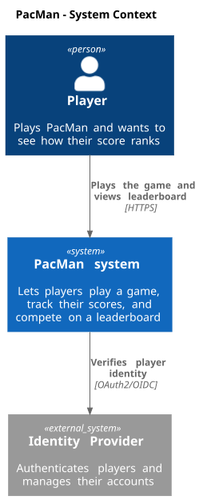

# 3. System Scope and Context

## System Boundary

The PacMan system comprises the Game Client, the Game API, and the Game
Database, which together let a player play the game, submit a score, and view
the leaderboard. Players
interact with it over HTTPS. Google Sign-In is an external partner: it owns
player accounts and authenticates players, but it is not part of this system.

The diagram source is [c4-context.puml](./diagrams/c4-context.puml) and is
reused here unchanged. It shows the system as a single element; Chapter 5 opens
that boundary into containers. The Identity Provider shown in the diagram is
Google Sign-In, the external partner chosen in ADR-001.

A player can play the game and view the leaderboard without logging in. Only
score submission requires the player to sign in with Google.

## Business Context

| Partner | Goes into the PacMan system | Goes out of the PacMan system | Note |
|---------|-----------------------------|-------------------------------|------|
| Player - playing | Start/play commands and movement input | Rendered maze, current game state, final score | No login required. |
| Player - viewing the leaderboard | Request to see the leaderboard, with no credentials | Ranked list of submitted scores | No login required. |
| Player - submitting a score | Final score, play time, and proof of identity from Google sign-in | Submission result (accepted or rejected) | This is the only interaction that requires login. |
| Google Sign-In (external) | ID token that asserts the player's identity | Sign-in request/redirect for the player | Accounts are managed outside the PacMan system. |

## Technical Context

| Interface | Direction | Protocol / format | Authentication | Purpose |
|-----------|-----------|-------------------|----------------|---------|
| Game input and canvas | Player to Game Client | Keyboard/pointer events and HTML5 Canvas rendering, local to the browser | None | Play the game at frame rate with no network dependency. |
| Leaderboard read | Game Client to Game API | REST/JSON over HTTPS, read request | None; no ID token is sent | Show the ranked scores to anyone. |
| Score submission | Game Client to Game API | REST/JSON over HTTPS, write request | OIDC ID token in the request | Record a score for a signed-in player. |
| Score and leaderboard storage | Game API to Game Database (SQLite), through the Repository layer | Local SQL on the database file | Internal to the system | Persist and rank scores. |
| Player sign-in | Game Client to Google Sign-In | OAuth2/OIDC over HTTPS | Managed by Google | Let the player obtain an ID token. |
| ID token verification | Game API to Google Sign-In | OAuth2/OIDC over HTTPS | Signed ID token | Confirm the player's identity before accepting a score. |

The leaderboard read carries no credentials. The ID token is sent only with a
score submission.

## Inside and Outside the System Scope

**Inside the scope**

- The Game Client: game loop, game logic, rendering, input handling, and score
  calculation.
- The Game API: score submission with ID-token verification and leaderboard
  reads.
- Persistence of scores in SQLite behind the Repository layer.
- The REST/JSON contract between the Game Client and the Game API.

**Outside the scope**

- Google Sign-In and all player account management.
- The player's device, browser, and input hardware.
- Any additional identity provider or local password store.
- Any multiplayer or real-time shared game service.
- Any anti-cheat service beyond plausibility checks on submitted scores.
- No managed cloud platform; production is a single Docker VM (see Chapter 7).
