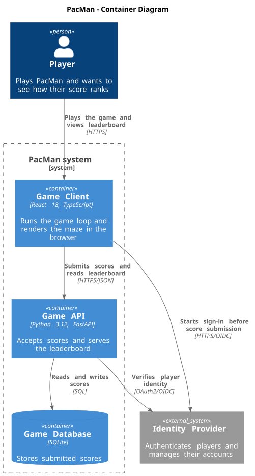
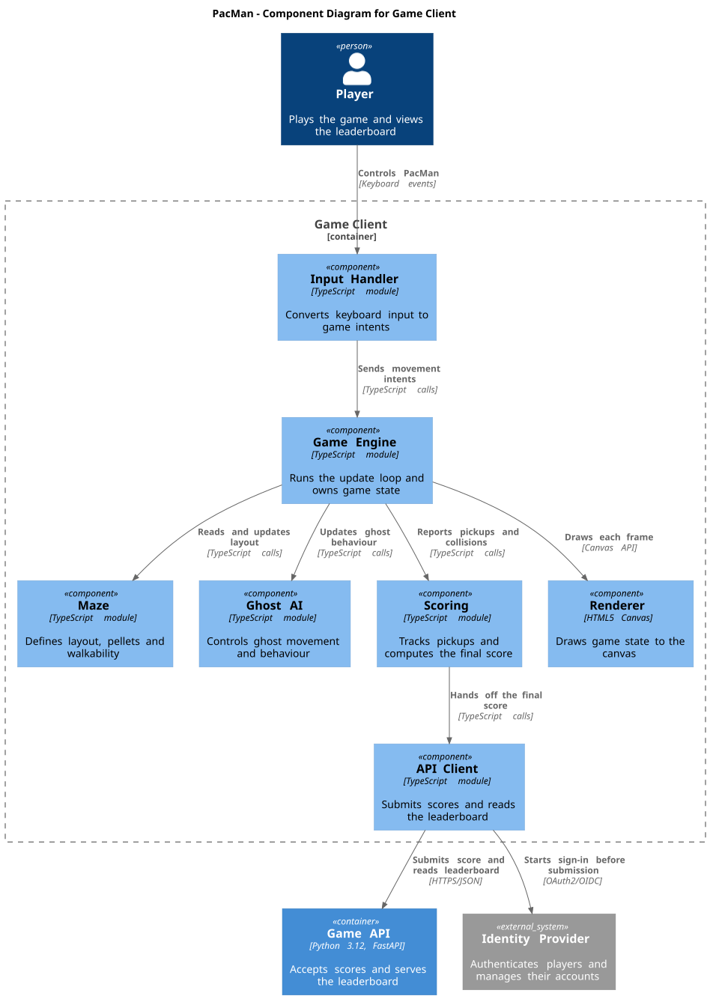
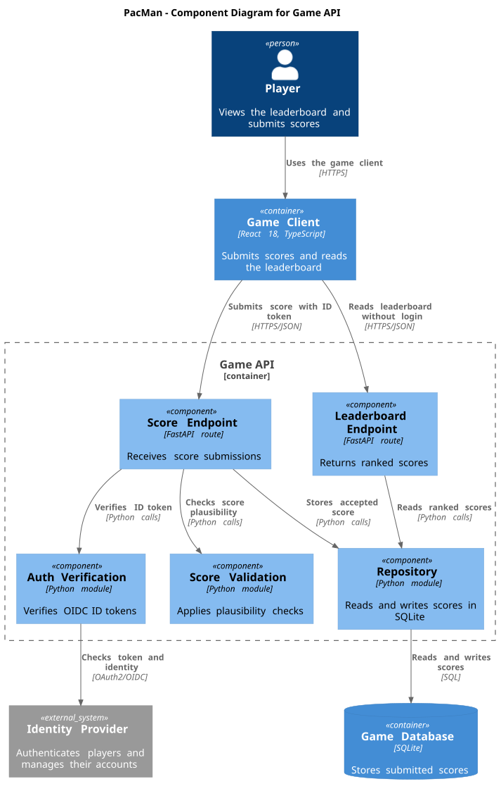

# 5. Building Block View

This chapter opens the system boundary from Chapter 3 into containers and then
into the components inside the two containers the team builds. The diagrams use
Level 2 and Level 3 C4 notation; deployment details are left for Chapter 7.

## Bounded Contexts

| Context | Owner | Model and language | Note |
|---------|-------|--------------------|------|
| Gameplay | Game Client | Maze, pellet, ghost, life, game score | Lives only in the browser during a game; not persisted. |
| Leaderboard | Game API and Game Database | Submitted score, play time, ranking, leaderboard entry | Persistent; owns validation and storage. |
| Identity (external) | Google Sign-In | Player account, ID token | Owned by an external system; not built here. |

The Game Client's API Client translates a Gameplay score into a Leaderboard
submission and carries the external ID token. It is the anti-corruption layer
between the Gameplay and Leaderboard contexts; the API never sees the internal
game model.

## Container View

Source: [c4-container.puml](./diagrams/c4-container.puml).

The browser runs the Game Client, which owns the game loop. The Game API has no
role in rendering or input; it handles score submission and leaderboard reads.
Only the Score submission path carries an ID token; the leaderboard path does
not.

## Component View - Game Client

Source: [c4-component-game-client.puml](./diagrams/c4-component-game-client.puml).

The Game Engine updates game state and calls the Maze, Ghost AI, Scoring, and
Renderer components. Input Handler supplies intents. Scoring hands the final
score to the API Client, which is the only component that talks to the API and
to the identity provider.

## Component View - Game API

Source: [c4-component-game-api.puml](./diagrams/c4-component-game-api.puml).

The Score Endpoint uses Auth Verification and Score Validation before writing
through the Repository. The Leaderboard Endpoint reads through the same
Repository and needs no ID token.

## Player Data Stored

For each player the Game Database stores only the Google subject ID and display
name. Email address is not stored, and the ID token is verified and then
discarded; it is never persisted.

## Building Block Responsibilities

| Level | Building block | Bounded context | Responsibility |
|-------|----------------|-----------------|----------------|
| Container | Game Client (React 18, TypeScript) | Gameplay | Runs the game loop, renders the maze, handles input, computes the score, and talks to the API. |
| Container | Game API (Python 3.12, FastAPI) | Leaderboard | Receives scores, verifies identity, validates submissions, and serves the leaderboard. |
| Container | Game Database (SQLite) | Leaderboard | Stores submitted scores for ranking. |
| External | Identity Provider (Google Sign-In) | Identity (external) | Authenticates players and issues ID tokens. |
| Component | Game Engine | Gameplay | Advances game state each frame and coordinates the other game components. |
| Component | Maze | Gameplay | Holds the layout, pellets, and walkability rules. |
| Component | Ghost AI | Gameplay | Determines ghost movement and behaviour. |
| Component | Scoring | Gameplay | Tracks pickups and collisions and computes the final score. |
| Component | Renderer | Gameplay | Draws the current game state to the HTML5 Canvas. |
| Component | Input Handler | Gameplay | Converts keyboard input into movement intents. |
| Component | API Client | Gameplay / Leaderboard boundary | Submits the score with the ID token and reads the leaderboard; translates between contexts. |
| Component | Score Endpoint | Leaderboard | Receives score submissions over REST/JSON. |
| Component | Leaderboard Endpoint | Leaderboard | Returns ranked scores without requiring login. |
| Component | Auth Verification | Leaderboard | Verifies the OIDC ID token before a score is accepted. |
| Component | Score Validation | Leaderboard | Applies plausibility checks to submitted scores. |
| Component | Repository | Leaderboard | Reads and writes scores in SQLite behind a simple interface. |
