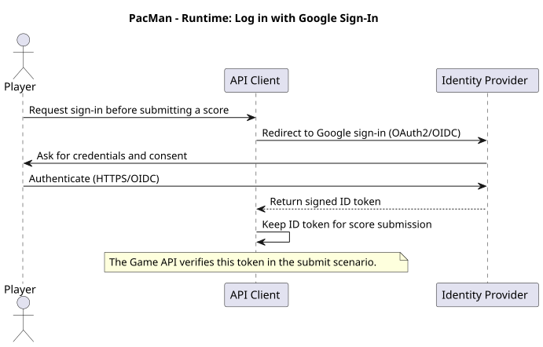
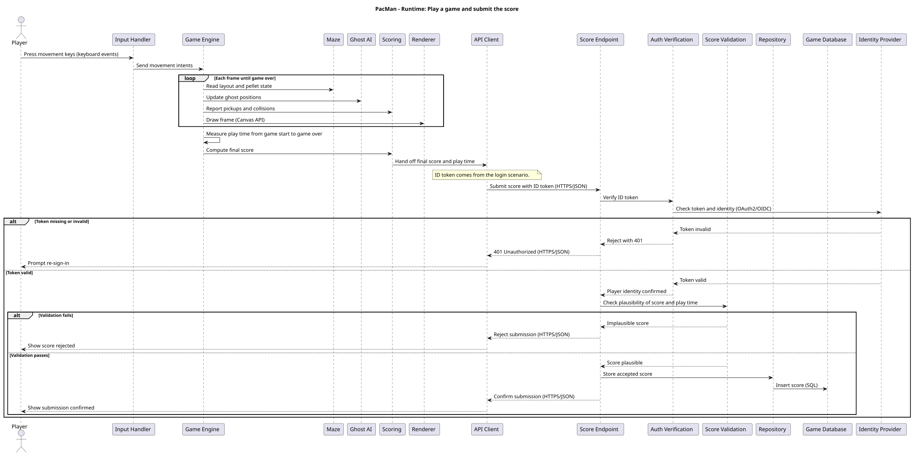
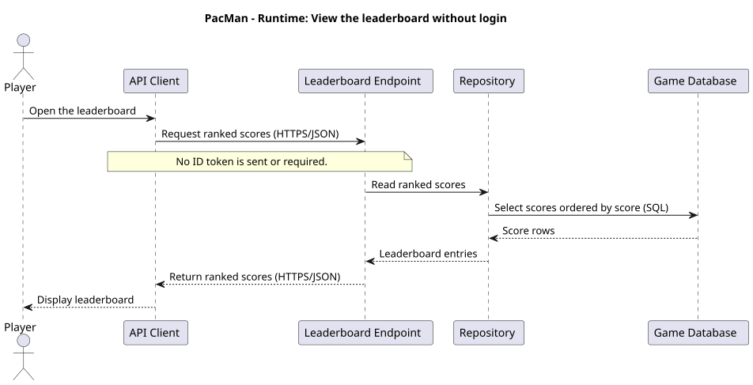

# 6. Runtime View

These scenarios use only the building blocks introduced in Chapter 5. The game
loop stays inside the Game Client; only score submission and leaderboard reads
cross the network to the Game API.

## Log in with Google Sign-In

Source: [runtime-login.puml](./diagrams/runtime-login.puml).

The player asks the API Client to sign in when they want to submit a score. The
API Client redirects the player to Google Sign-In using OAuth2/OIDC; after the
player authenticates, the signed ID token is returned and kept by the API
Client. No score is sent in this scenario, and the Game API does not verify the
token until the submission scenario.

## Play a game and submit the score

Source: [runtime-play-and-submit.puml](./diagrams/runtime-play-and-submit.puml).

The player's keys become movement intents for the Game Engine. On each frame
the engine reads the Maze, updates Ghost AI and Scoring, and draws through the
Renderer, all without a network call. The Game Engine measures play time from
game start to game over. At game over, Scoring hands the final score and play
time to the API Client, which posts them with the ID token. The Score Endpoint
verifies the token through Auth Verification and the Identity Provider; a
missing or invalid token returns 401 and prompts re-sign-in. With a valid
token, Score Validation checks plausibility. A failed check rejects the
submission and shows the reason to the player; otherwise the Repository stores
the score in SQLite and a confirmation is returned.

## View the leaderboard without login

Source: [runtime-view-leaderboard.puml](./diagrams/runtime-view-leaderboard.puml).

The player opens the leaderboard and the API Client requests ranked scores from
the Leaderboard Endpoint. No ID token is sent and no sign-in is needed. The
Repository reads the ordered scores from the Game Database, and the endpoint
returns them to the API Client for display.
