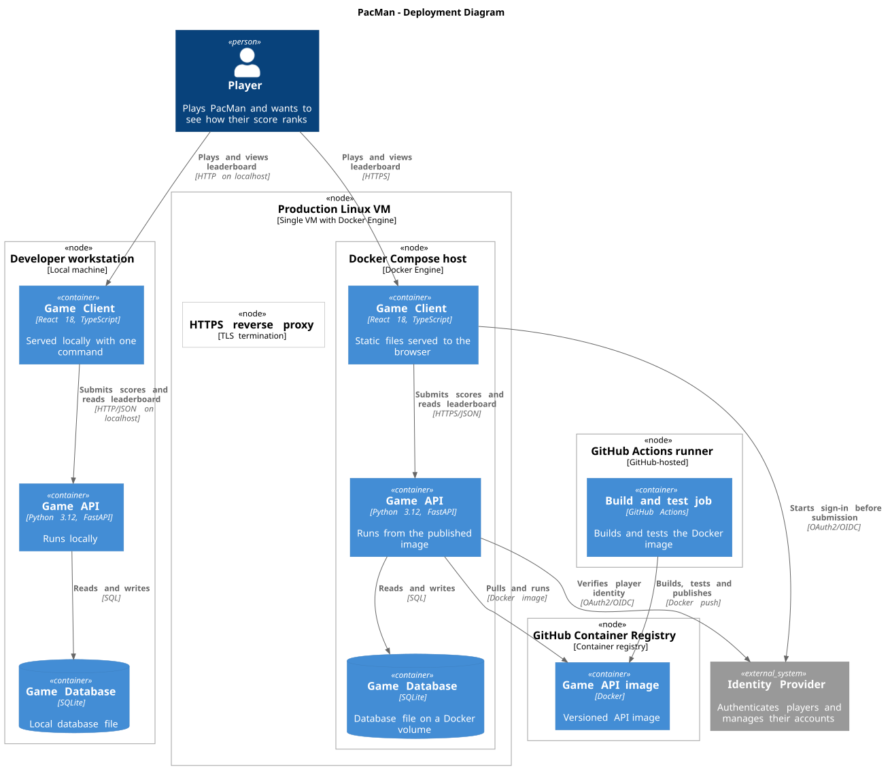

# 7. Deployment View

The chosen production option is a single Linux VM running Docker Compose with
two services: `api` (FastAPI) and `web` (static server and reverse proxy serving
the built SPA and forwarding API calls). SQLite stays on a Docker volume. No
managed cloud platform is assumed.

Source: [deployment.puml](./diagrams/deployment.puml).

## Local Development

A developer starts the `api` and `web` services with one command, for example
`docker compose up`. The `web` service serves the SPA on localhost and forwards
API calls to `api`. Google Sign-In uses localhost as its registered origin for
development. SQLite is a file on a local Docker volume, so no database server
is installed or started. The only external dependency is Google Sign-In when a
score is submitted.

## CI Environment

GitHub Actions runs on every push and pull request. It runs the pytest and
pytest-bdd backend tests and the Vitest frontend game-logic tests, builds the
Game API image, and publishes that image to GitHub Container Registry. The
static SPA build is produced in the same pipeline. A failed test or image build
blocks the change.

## Production Environment

One Linux VM with Docker Engine runs the `api` and `web` services under Docker
Compose. The `web` service runs Caddy, which terminates TLS for a production
domain name, serves the built SPA, and forwards API calls to `api`. That domain
must be registered as an allowed Google origin. The `api` service runs the
image published by CI. SQLite is a file on a named Docker volume, which is the
only persistent state and is the unit to back up.

Deployment is a pull of the published image followed by a Compose restart. The
VM also owns OS updates, TLS certificate renewal, and volume backups.

This option is intentionally simple. It accepts a single point of failure and
no automatic scaling, which is appropriate for the kata; moving to a managed
container platform later does not change the container boundaries in Chapter 5.

## Container Mapping

| Service / container | Local development | CI | Production |
|---------------------|-------------------|----|------------|
| `web` (Caddy + built SPA / Game Client) | Serves the SPA on localhost with one command | SPA build produced by the pipeline | Caddy serves the SPA and forwards API calls; TLS for the domain |
| `api` (FastAPI / Game API) | Runs locally in Docker | Image built, tested, and published to GitHub Container Registry | Container started from the published image |
| Game Database (SQLite) | File on a local Docker volume; no database server | Temporary database for tests | File on a named Docker volume on the VM |
